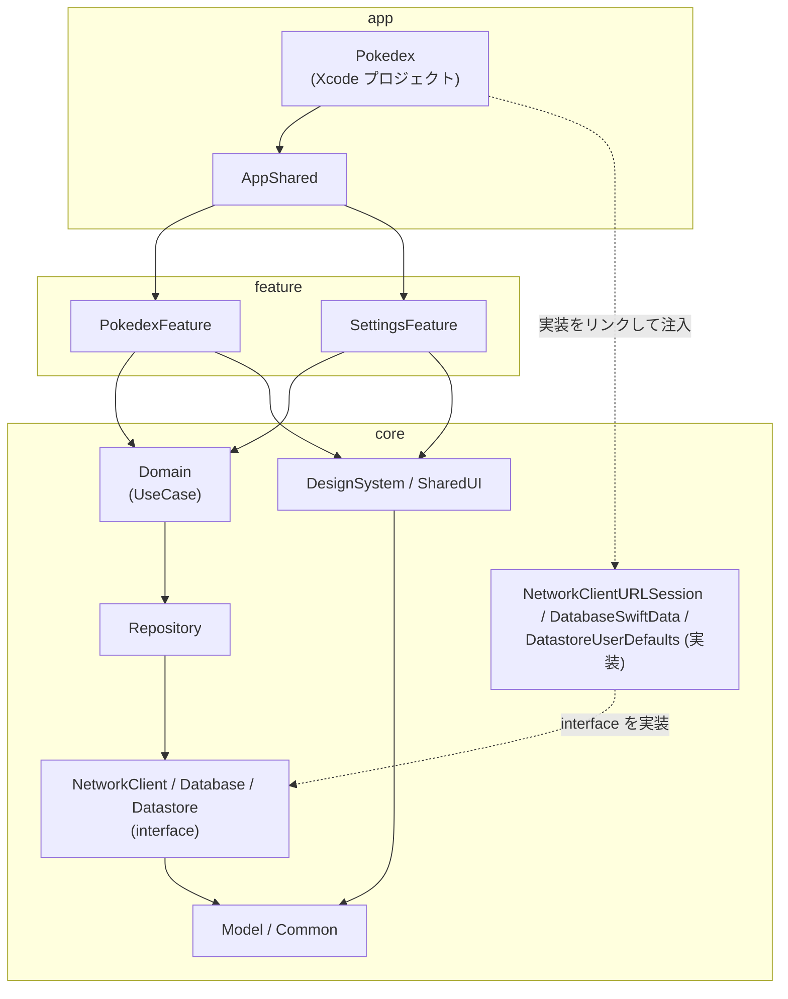
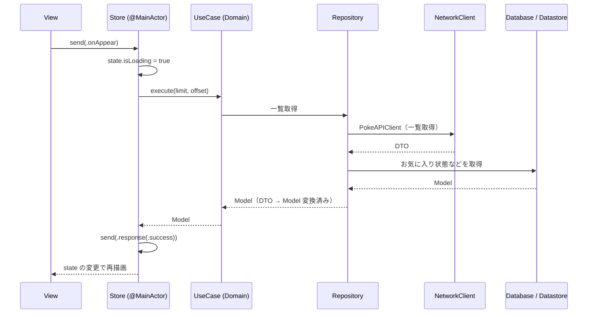
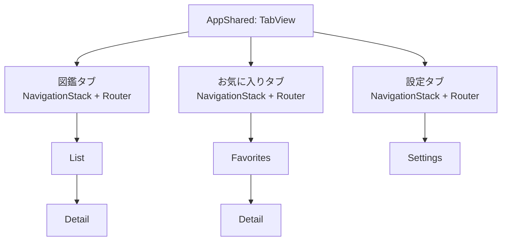
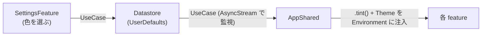

# アーキテクチャ

swift-pokedex の設計の全体像をまとめます。変わりにくい設計ルールをここに書き、決定の経緯は [ADR](./adr/README.md) に残します。

- モジュール間の詳細な依存グラフ: [package-dependencies.md](./package-dependencies.md)
- DI の詳細: [dependency-injection.md](./dependency-injection.md)
- データ層の詳細: [data-layer.md](./data-layer.md)

## 目次

- [設計方針](#設計方針)
- [3層構成](#3層構成)
- [各モジュールの責務](#各モジュールの責務)
- [状態管理（MVI）](#状態管理mvi)
- [データフロー](#データフロー)
- [ナビゲーション](#ナビゲーション)
- [テーマ色の伝搬](#テーマ色の伝搬)
- [Concurrency の方針](#concurrency-の方針)
- [関連 ADR](#関連-adr)

## 設計方針

| 方針 | 内容 |
| --- | --- |
| 標準優先 | 標準で足りるものは標準を使い、実務で定番のライブラリだけを入れる（[ADR 0005](./adr/0005-external-libraries.md)） |
| 単方向データフロー | View は State を表示し、操作は Action として Store に送る。State を書き換えるのは Store だけ |
| interface と実装の分離 | NetworkClient / Database / Datastore は interface と実装を別モジュールにし、実装をリンクするのは App ターゲットだけ |
| テスト容易性 | 依存は「クロージャを持つ struct」で定義し、テストでは差し替える。Store は `send` の完了を待てる |
| Swift 6 strict concurrency | Swift 6 言語モードで、データ競合をコンパイル時に潰す |

## 3層構成

モジュールは `app` / `feature` / `core` の3層に分けます。依存は上から下への一方向だけです。



| 層 | 役割 | Flutter / Android での対応 |
| --- | --- | --- |
| app | 画面の組み立て（TabView、ナビゲーション、テーマ適用）と、実装の注入 | `app/mobile`, `app/shared` |
| feature | ドメイン単位の画面と Store。feature 同士は依存しない | `feature/*` |
| core | データ取得、ビジネスロジック、共通 UI、共通型 | `core/*` |

ルールは次のとおりです。モジュールごとの依存先は [package-dependencies.md](./package-dependencies.md) を参照してください。

- feature は Repository / NetworkClient / Database / Datastore を直接 import せず、必ず Domain の UseCase 経由にします（単純な委譲でも UseCase を置きます）。
- feature 同士は依存しません。core は feature / app に依存しません。
- 実装モジュールを依存に持つのは App ターゲットだけです。

## 各モジュールの責務

### app

| モジュール | 責務 |
| --- | --- |
| Pokedex | `@main` のアプリ本体。実装モジュールをリンクして依存を注入する |
| AppShared | ルート View、TabView、タブごとの NavigationStack と Router、テーマ適用 |

### feature

| モジュール | 責務 |
| --- | --- |
| PokedexFeature | 図鑑ドメイン。List / Detail / Favorites をフォルダで分ける。お気に入りも含む |
| SettingsFeature | テーマ色の変更、ライセンス表示、言語設定への誘導 |

### core

| モジュール | 責務 |
| --- | --- |
| Common | 共通ユーティリティ、エラー型 |
| Model | ドメインの Entity（Sendable な struct / enum） |
| NetworkClient | interface。PokeAPIClient と DTO |
| NetworkClientURLSession | 実装。URLSession + swift-http-types |
| Database | interface。FavoriteStore など |
| DatabaseSwiftData | 実装。`@Model`、`@ModelActor` |
| Datastore | interface。設定値（テーマ色） |
| DatastoreUserDefaults | 実装。UserDefaults |
| Repository | NetworkClient / Database / Datastore を組み合わせ、DTO を Model に変換する |
| Domain | UseCase。言語コードの変換とフォールバックもここで行う |
| DesignSystem | テーマ、色、タイプバッジ、RemoteImage（Nuke をラップ） |
| SharedUI | ドメインを知っている共通 UI（PokemonCard、PokemonRow など） |
| TestSupport | フィクスチャ、テスト用ヘルパー |

## 状態管理（MVI）

自作の MVI を使います（[ADR 0002](./adr/0002-state-management-custom-mvi.md)）。画面ごとに次の3つを用意します。

| 要素 | 型 | 役割 |
| --- | --- | --- |
| State | struct | 画面の状態。値型なので Store 内で直接書き換えてよい |
| Action | enum（関連値あり） | ユーザー操作、非同期処理の結果、親への通知をすべて表す |
| Store | `@MainActor @Observable final class` | `private(set) var state` と `func send(_ action:)` を持つ |

### send の振る舞い

- `send` の中で `switch` して State を更新します。BLoC の `on<Event>` ハンドラに相当します。
- 非同期処理は `send` の中で `Task` を起動し、結果を `.response(...)` のような Action として `send` し直します。
- `send` は `@discardableResult` で起動した `Task<Void, Never>?` を返します。テストでは `await store.send(.onAppear)?.value` で完了を待ちます（初期方針。実装しながら見直してよい）。
- 検索の debounce やキャンセルは、Store が `Task` を保持して `cancel()` します。待機には `Task.sleep` を使います。
- 親に伝えるイベントは Action の delegate ケース（例: `.delegate(.selectPokemon(id))`）にまとめます。
- 依存（UseCase）は `@Dependency` で受け取ります。

### コード例（一覧画面）

以下はあくまで「例」です。型名やプロパティは実装時に変わります。

```swift
import Dependencies
import DependenciesMacros
import Foundation
import Observation
import SwiftUI

// --- Model / Domain（例） ---

struct PokemonSummary: Sendable, Equatable, Identifiable {
    let id: Int
    let name: String
}

struct PokemonPage: Sendable, Equatable {
    let items: [PokemonSummary]
    let hasNext: Bool
}

/// UseCase。クロージャを持つ struct として定義する。
@DependencyClient
struct FetchPokemonListUseCase: Sendable {
    var execute: @Sendable (_ limit: Int, _ offset: Int) async throws -> PokemonPage
}

extension FetchPokemonListUseCase: TestDependencyKey {
    static let testValue = FetchPokemonListUseCase()
}

extension DependencyValues {
    var fetchPokemonList: FetchPokemonListUseCase {
        get { self[FetchPokemonListUseCase.self] }
        set { self[FetchPokemonListUseCase.self] = newValue }
    }
}

// --- PokedexFeature / List（例） ---

@MainActor
@Observable
final class PokemonListStore {
    struct State: Equatable {
        var items: [PokemonSummary] = []
        var searchText = ""
        var isLoading = false
        var hasNext = true
        var errorMessage: String?

        /// 検索はローカル絞り込み。
        var visibleItems: [PokemonSummary] {
            searchText.isEmpty
                ? items
                : items.filter { $0.name.localizedCaseInsensitiveContains(searchText) }
        }
    }

    enum Action {
        case onAppear
        case reachedBottom
        case searchTextChanged(String)
        case searchDebounced(String)
        case response(Result<PokemonPage, any Error>)
        case rowTapped(PokemonSummary)
        case delegate(Delegate)

        enum Delegate: Equatable {
            case selectPokemon(Int)
        }
    }

    private(set) var state = State()

    @ObservationIgnored
    @Dependency(\.fetchPokemonList) private var fetchPokemonList

    private let pageSize = 20
    private var loadTask: Task<Void, Never>?
    private var searchTask: Task<Void, Never>?

    /// 親への通知を受け取るクロージャ（例）。
    var onDelegate: (@MainActor (Action.Delegate) -> Void)?

    @discardableResult
    func send(_ action: Action) -> Task<Void, Never>? {
        switch action {
        case .onAppear:
            guard state.items.isEmpty else { return nil }
            return load()

        case .reachedBottom:
            guard state.hasNext, !state.isLoading else { return nil }
            return load()

        case let .searchTextChanged(text):
            state.searchText = text
            searchTask?.cancel()
            searchTask = Task { [weak self] in
                try? await Task.sleep(for: .milliseconds(300))
                guard !Task.isCancelled else { return }
                self?.send(.searchDebounced(text))
            }
            return searchTask

        case .searchDebounced:
            // 例: ここで絞り込み結果に応じた追加処理を行う。
            return nil

        case let .response(.success(page)):
            state.isLoading = false
            state.items += page.items
            state.hasNext = page.hasNext
            return nil

        case let .response(.failure(error)):
            state.isLoading = false
            state.errorMessage = error.localizedDescription
            return nil

        case let .rowTapped(pokemon):
            return send(.delegate(.selectPokemon(pokemon.id)))

        case let .delegate(event):
            onDelegate?(event)
            return nil
        }
    }

    private func load() -> Task<Void, Never> {
        state.isLoading = true
        state.errorMessage = nil
        let offset = state.items.count
        let limit = pageSize
        let fetch = fetchPokemonList
        loadTask?.cancel()
        let task = Task { [weak self] in
            let result: Result<PokemonPage, any Error>
            do {
                result = .success(try await fetch.execute(limit, offset))
            } catch {
                result = .failure(error)
            }
            guard !Task.isCancelled else { return }
            self?.send(.response(result))
        }
        loadTask = task
        return task
    }
}

struct PokemonListView: View {
    @State private var store = PokemonListStore()

    var body: some View {
        List(store.state.visibleItems) { pokemon in
            Button(pokemon.name) { store.send(.rowTapped(pokemon)) }
                .onAppear {
                    if pokemon.id == store.state.items.last?.id {
                        store.send(.reachedBottom)
                    }
                }
        }
        .searchable(
            text: Binding(
                get: { store.state.searchText },
                set: { store.send(.searchTextChanged($0)) }
            )
        )
        .task { store.send(.onAppear) }
    }
}
```

補足です。

- `@Observable` のクラスで `@Dependency` を使うときは `@ObservationIgnored` を付けます。
- `@Observable` は View が読んだプロパティだけを追跡します。Signals に近い動きです。
- 非同期処理は Task を保持して再実行時にキャンセルします。キャンセル後に古い結果を反映しないよう、`Task.isCancelled` を確認します。
- 親への通知の渡し方（クロージャか、Router が Store を監視するか）は実装時に決めます。上の `onDelegate` は一例です。

### テストでの待ち方

```swift
import Dependencies
import Testing

@MainActor
struct PokemonListStoreTests {
    @Test func onAppearで先頭ページを読み込む() async {
        let store = withDependencies {
            $0.fetchPokemonList.execute = { _, _ in
                PokemonPage(items: [PokemonSummary(id: 1, name: "bulbasaur")], hasNext: false)
            }
        } operation: {
            PokemonListStore()
        }

        await store.send(.onAppear)?.value

        #expect(store.state.items.count == 1)
        #expect(store.state.isLoading == false)
    }
}
```

`send` が返す Task の `value` を待つことで、非同期処理の完了後に State を検証できます。

### 他の状態管理との対応

| 本プロジェクト | BLoC (Flutter) | Kotlin MVI | useReducer (React) |
| --- | --- | --- | --- |
| Action | Event | Intent | action |
| State（struct） | State | data class (State) | state |
| `send` 内の `switch` | `on<Event>` ハンドラ | reducer | reducer |
| `Task` で起動する非同期処理 | emit を伴う非同期ハンドラ | SideEffect | useEffect / dispatch の非同期処理 |
| delegate Action | 親への callback / listener | SideEffect (Event) | 親への callback |
| `@Dependency` | Injectable / get_it | DI（Hilt など） | Context |

## データフロー



- DTO はネットワーク用モデルで、Repository で Model に変換します。View と Store は DTO を知りません。
- NetworkClient の interface は HTTP レベルではなく API レベル（PokeAPIClient）です。
- Database は interface の裏で SwiftData を隠します。View で `@Query` は使いません。
- キャッシュ方針、各クライアントの詳細は [data-layer.md](./data-layer.md) を参照してください。

## ナビゲーション

| 要素 | 内容 |
| --- | --- |
| TabView | AppShared が持つ。タブは図鑑 / お気に入り / 設定 |
| NavigationStack | タブごとに1つ |
| Router | タブごとの `@Observable` クラス。`path` を持つ |
| Route | PokedexFeature が提供する enum と `navigationDestination` |



- List から Detail、Favorites から Detail の遷移は、同じ feature の中で完結します。
- feature をまたぐ遷移が必要になったら、delegate Action を AppShared の Router が受け取って処理します。現時点ではまたぐ遷移はありません。
- 例（Route と Router の形）。あくまで一例です。

```swift
import Observation
import SwiftUI

enum PokedexRoute: Hashable {
    case detail(id: Int)
}

@MainActor
@Observable
final class PokedexRouter {
    var path: [PokedexRoute] = []
}
```

## テーマ色の伝搬

PokedexFeature は Environment から読むだけで、SettingsFeature には依存しません。



1. SettingsFeature が UseCase 経由で Datastore に保存します。
2. AppShared が UseCase（AsyncStream で監視）で値を受け取ります。
3. AppShared が `.tint()` と DesignSystem の Theme を Environment で全体に流します。
4. 各 feature は Environment から読み取ります。

## Concurrency の方針

| 対象 | 方針 |
| --- | --- |
| Store | `@MainActor`。State の更新は常にメインアクターで行う |
| Model / DTO | `Sendable` な struct / enum にする |
| 依存クライアントのクロージャ | `@Sendable` を付ける |
| SwiftData | `ModelContext` は Sendable ではないため、`@ModelActor` を付けた actor で包む。`@Model` 型は DatabaseSwiftData の外に出さない |
| 非同期処理 | Store が `Task` を保持してキャンセルする。構造化されたものは async/await で書く |
| AsyncStream | 設定値の監視など、継続的に変わる値の公開に使う |

- Swift 6 言語モードでデータ競合を設計段階で避けます。警告の扱いなど具体的なビルド設定は Phase 0 で決めます。
- Flutter の Isolate と違い、同じアクターに隔離された値は共有できます。アクターの境界を越える値だけが Sendable である必要があります。

## 関連 ADR

| ADR | 内容 |
| --- | --- |
| [0002 状態管理](./adr/0002-state-management-custom-mvi.md) | 自作 MVI を採用し、TCA を不採用にした経緯 |
| [0003 モジュール構成](./adr/0003-multi-module-structure.md) | app / feature / core の3層とルート Package.swift |
| [0004 DI](./adr/0004-dependency-injection.md) | swift-dependencies と interface / 実装の分離 |

ADR の一覧は [adr/README.md](./adr/README.md) を参照してください。
