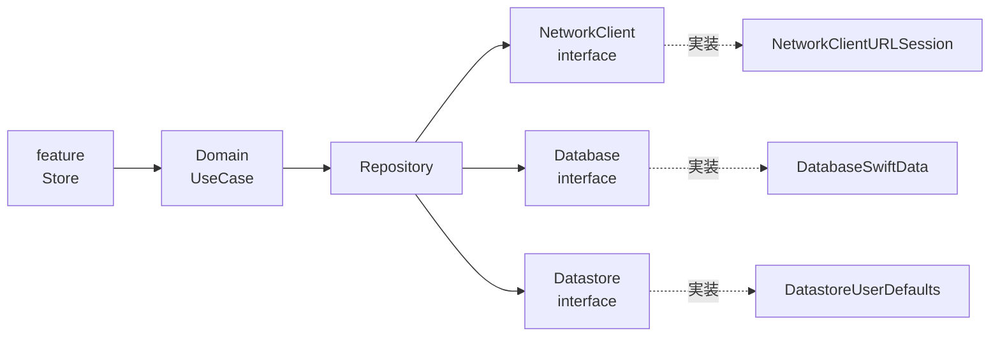

# データ層

PokeAPI からのデータ取得、永続化、設定値の保存、およびそれらをまとめる Repository / UseCase の設計をまとめます。ここに書いた型名や関数名は設計の「案」で、実装時に調整します。

## 全体像



- feature は Repository / NetworkClient / Database / Datastore を直接 import せず、必ず Domain の UseCase 経由でデータを扱います。
- 実線は依存、点線は「interface に対する実装」です。実装モジュールをリンクするのは App ターゲット（`app/Pokedex`）だけです。
- 依存ルール全体は [package-dependencies.md](./package-dependencies.md)、DI の仕組みは [dependency-injection.md](./dependency-injection.md) を参照してください。

## PokeAPI の概要

| 項目 | 内容 |
| --- | --- |
| ベース URL | `https://pokeapi.co/api/v2/` |
| 認証 | なし |
| メソッド | HTTP GET のみ |
| キャッシュヘッダ | `cache-control: public, max-age=86400`（1日）、`etag` あり。Cloudflare 経由で配信 |
| OpenAPI 定義 | 公式のものは無い（[issue #528](https://github.com/PokeAPI/pokeapi/issues/528) で議論されているのみ） |

公式ドキュメントは [PokeAPI docs](https://pokeapi.co/docs/v2) です。上記は 2026年10月に実際に確認した内容です。

### Fair Use Policy の要点

- 取得したリソースは必ずローカルにキャッシュします。
- レート制限は 2018年11月に撤廃されましたが、ホスティング費用削減のためリクエスト頻度は抑えます。
- 守らない場合、IP が永久 BAN される可能性があります。

このため、キャッシュは任意の最適化ではなく必須要件として扱います（[キャッシュ方針](#キャッシュ方針)を参照）。

## 使うエンドポイント

| エンドポイント | 用途 | 主なフィールド | 使う画面 |
| --- | --- | --- | --- |
| `GET /pokemon?limit=20&offset=0` | 一覧のページング取得 | `count`、`next`、`previous`、`results`（`name` と `url` の配列） | 一覧 |
| `GET /pokemon?limit={count 以上}` | 全件の名前リスト取得（ローカル検索用） | 同上 | 検索 |
| `GET /pokemon/{id または name}` | 詳細 | `types`、`stats`、`sprites`（公式アートワークは `sprites.other["official-artwork"].front_default`） | 詳細、お気に入り一覧 |
| `GET /pokemon-species/{id}` | 名前のローカライズ、説明文、進化チェーンへの入口 | `names`（`name` と `language.name` の配列）、`flavor_text_entries`、`evolution_chain.url` | 一覧・詳細 |
| `GET /evolution-chain/{id}` | 進化チェーン | `chain`（`species` と `evolves_to` の配列を持つ再帰構造） | 詳細 |
| `GET /type/{name}` | タイプフィルタ | `pokemon`（`pokemon.name` と `pokemon.url` を持つ要素の配列） | 一覧 |

## データ取得の方針

### ページング

- `limit` / `offset` 方式です。1ページ 20件で取得します。
- レスポンスの `count`（2026年10月時点で 1351）で全件数が分かります。`next` が `null` でなければ続きがあります。
- 無限スクロールは、末尾付近の行が表示されたときに次の `offset` を読み込む形で実装します。

### ID の取り出し方

一覧の `results` は `name` と `url` だけを返します。ID は `url` の末尾のパス要素から取り出します。

```swift
// 例: "https://pokeapi.co/api/v2/pokemon/25/" -> 25
func pokemonID(from url: URL) -> Int? {
    Int(url.pathComponents.last { $0 != "/" } ?? "")
}
```

ID が 10000 を超えるものはフォーム違いなどの pokemon です。

### 名前検索

- 名前検索の API はありません。
- 全件の名前リスト（`limit` を `count` 以上にして 1回取得）をキャッシュし、ローカルで絞り込みます。
- 日本語名での検索は全 species の名前が必要になります。

### 言語コードと変換ルール

`pokemon-species` の `names` に含まれる言語コードは次のとおりです。

| コード | 内容 |
| --- | --- |
| `ja-hrkt` | 日本語（カナ表記） |
| `ja` | 日本語（漢字かな混じり） |
| `ja-roma` | 日本語（ローマ字） |
| `en` | 英語 |
| `ko` | 韓国語 |
| `zh-hant` | 中国語（繁体字） |
| `zh-hans` | 中国語（簡体字） |
| `fr` / `de` / `es` / `it` / `es-419` | フランス語 / ドイツ語 / スペイン語 / イタリア語 / ラテンアメリカスペイン語 |

アプリの言語に追従させます（別設定にはしません）。

- `Bundle.main.preferredLocalizations.first` を PokeAPI の言語コードに変換します。`ja` は `ja-hrkt`、`en` は `en` です。
- 該当言語の名前が無ければ `en` にフォールバックします。
- この変換とフォールバックは Domain の UseCase で行います。

選んだ理由と検討した代替案は [ADR 0007](./adr/0007-localization.md) を参照してください。

## NetworkClient と NetworkClientURLSession

| モジュール | 役割 | 主な依存 |
| --- | --- | --- |
| `NetworkClient`（interface） | `PokeAPIClient` と DTO（ネットワーク用モデル）を定義する | Common、Dependencies、DependenciesMacros |
| `NetworkClientURLSession`（実装） | URLSession + swift-http-types で `liveValue` を提供する | NetworkClient、HTTPTypes、HTTPTypesFoundation、Dependencies |

interface は HTTP レベルではなく API レベル（一覧取得、詳細取得など）にします。Repository のテストで API レスポンスを差し替えやすくするためです。

### PokeAPIClient の例

`@DependencyClient` を使った「クロージャをプロパティに持つ struct」で定義します。以下はあくまで例です。

```swift
import Dependencies
import DependenciesMacros

@DependencyClient
public struct PokeAPIClient: Sendable {
  public var fetchPokemonList: @Sendable (_ limit: Int, _ offset: Int) async throws -> PokemonListDTO
  public var fetchPokemon: @Sendable (_ idOrName: String) async throws -> PokemonDTO
  public var fetchPokemonSpecies: @Sendable (_ id: Int) async throws -> PokemonSpeciesDTO
  public var fetchEvolutionChain: @Sendable (_ id: Int) async throws -> EvolutionChainDTO
  public var fetchType: @Sendable (_ name: String) async throws -> TypeDTO
}

extension PokeAPIClient: TestDependencyKey {
  public static let testValue = PokeAPIClient()
}

extension DependencyValues {
  public var pokeAPIClient: PokeAPIClient {
    get { self[PokeAPIClient.self] }
    set { self[PokeAPIClient.self] = newValue }
  }
}
```

実装モジュール側で `DependencyKey` に準拠させて `liveValue` を追加します。`previewValue` は interface モジュール側で定義します。詳細は [dependency-injection.md](./dependency-injection.md) と [swift-dependencies の解説](https://github.com/pointfreeco/swift-dependencies/blob/main/Sources/Dependencies/Documentation.docc/Articles/LivePreviewTest.md) を参照してください。

### swift-http-types による GET の例

[swift-http-types](https://github.com/apple/swift-http-types) の `HTTPRequest` と、`HTTPTypesFoundation` が提供する `URLSession` 拡張を使います。以下は例です（`NetworkError` は仮の型）。

```swift
import Foundation
import HTTPTypes
import HTTPTypesFoundation

enum NetworkError: Error {
  case invalidURL
  case unexpectedStatus(Int)
}

func get(_ url: URL, session: URLSession) async throws -> Data {
  guard let request = HTTPRequest(method: .get, url: url) else {
    throw NetworkError.invalidURL
  }
  let (data, response) = try await session.data(for: request)
  guard response.status.kind == .successful else {
    throw NetworkError.unexpectedStatus(response.status.code)
  }
  return data
}
```

### DTO から Model への変換

- DTO は `NetworkClient` モジュールに置き、PokeAPI のレスポンス形状にそのまま合わせた `Codable` な struct にします。
- アプリ全体で使うモデルは `core/Model` に置く Sendable な struct / enum です。
- DTO から Model への変換は Repository で行います。feature や Domain は DTO を知りません。

Flutter では Freezed / json_serializable で書いていた部分は、Swift では struct・enum・`Codable` で足ります。

## Database と DatabaseSwiftData

| モジュール | 役割 |
| --- | --- |
| `Database`（interface） | `FavoriteStore` などの依存を定義する。Model 型だけを入出力に使う |
| `DatabaseSwiftData`（実装） | SwiftData の `@Model` と `@ModelActor` で実装する |

- お気に入りを SwiftData に保存します。
- `ModelContext` は Sendable ではないため、実装は `@ModelActor` を付けた actor で包みます。
- `@Model` 型は `DatabaseSwiftData` の外に出しません。外へ出すのは `core/Model` のモデルだけです。
- 公開方法は fetch 関数や `AsyncStream` にします。View で `@Query` は使いません。

選んだ理由と検討した代替案は [ADR 0006](./adr/0006-local-persistence.md) を参照してください。参考: [Apple SwiftData](https://developer.apple.com/documentation/swiftdata)。

## Datastore と DatastoreUserDefaults

| モジュール | 役割 |
| --- | --- |
| `Datastore`（interface） | 設定値（テーマ色）の読み書きと監視を定義する |
| `DatastoreUserDefaults`（実装） | `UserDefaults` で保存する |

- Flutter 版の `datastore` と `datastore_shared_preferences` の分割に相当します。
- テーマ色は Settings で変更し、`AsyncStream` で監視できるようにします。流れは SettingsFeature → UseCase → Datastore と保存し、App ターゲットが UseCase 経由で値を受け取って全体に流します（[architecture.md](./architecture.md) を参照）。

## Repository と UseCase

Repository は `NetworkClient` / `Database` / `Datastore` を組み合わせ、DTO を Model に変換します（Now in Android や Flutter 版の `core/data` に相当）。

### Repository の案

| Repository | 役割 | 使う interface |
| --- | --- | --- |
| `PokemonRepository` | 一覧、詳細、species、進化チェーン、タイプ別一覧、全件名前リストの取得と Model 変換 | NetworkClient |
| `FavoriteRepository` | お気に入りの追加・削除・一覧監視 | Database（必要に応じて NetworkClient） |
| `SettingsRepository` | テーマ色の保存と監視 | Datastore |

### UseCase

Domain の UseCase は、単純な委譲でも置きます（feature から Repository を直接触らせないためのルールです）。UseCase の例を挙げます。

| UseCase（案） | 内容 |
| --- | --- |
| 一覧取得 | `PokemonRepository` に委譲してページを返す |
| お気に入りの切り替え | `FavoriteRepository` に委譲する |
| テーマ色の監視 | `SettingsRepository` の値を `AsyncStream` で返す |
| ポケモン名の言語解決 | [言語コードと変換ルール](#言語コードと変換ルール)に従い、species の `names` から名前を選ぶ |

言語解決の例です（型名は仮で、あくまで例です）。

```swift
import Foundation

struct LocalizedName: Sendable {
  var languageCode: String
  var name: String
}

func resolvePokemonName(
  from names: [LocalizedName],
  preferredLocalization: String? = Bundle.main.preferredLocalizations.first
) -> String? {
  let code = switch preferredLocalization {
  case "ja": "ja-hrkt"
  default: "en"
  }
  return names.first { $0.languageCode == code }?.name
    ?? names.first { $0.languageCode == "en" }?.name
}
```

## キャッシュ方針

| 段階 | 方式 | 対象 |
| --- | --- | --- |
| 段階1 | `URLSession` の `URLCache`（ディスク容量を大きめに設定）による HTTP キャッシュ。PokeAPI の `max-age=86400` に従う | 全 GET レスポンス |
| 段階2 | SwiftData に保存する | 全件の名前リスト、species など、オフラインでも使いたいもの |

- 段階1で Fair Use Policy の「ローカルにキャッシュする」を満たします。
- 画像のメモリ・ディスクキャッシュは Nuke（DesignSystem 内）が担当します。

## エラーハンドリング

- `Common` にエラー型を置く程度に留めます。

## 関連 ADR

- [ADR 0006: 永続化](./adr/0006-local-persistence.md)
- [ADR 0007: 言語](./adr/0007-localization.md)

## 参考リンク

- [PokeAPI docs](https://pokeapi.co/docs/v2)
- [swift-http-types](https://github.com/apple/swift-http-types)
- [swift-dependencies](https://github.com/pointfreeco/swift-dependencies)
- [Apple SwiftData](https://developer.apple.com/documentation/swiftdata)
- [Apple Bundle.preferredLocalizations](https://developer.apple.com/documentation/foundation/bundle/preferredlocalizations)
