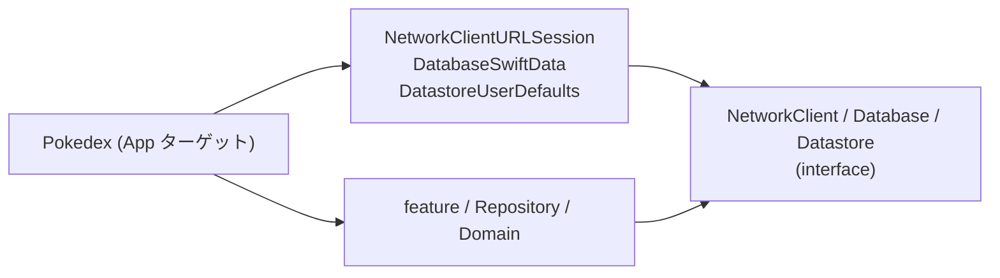
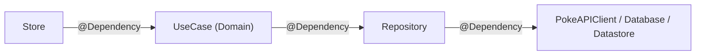

# 依存性注入

swift-pokedex では DI に [swift-dependencies](https://github.com/pointfreeco/swift-dependencies)(Point-Free)を使います。決定の経緯は [ADR 0004](adr/0004-dependency-injection.md) を参照してください。ここでは「どう書くか」を説明します。

> 本書のコードは書き方を示す「例」です。型名やメソッド名は実装時に変わる可能性があります。

## なぜ swift-dependencies か

| 観点 | 内容 |
| --- | --- |
| Riverpod 経験との相性 | `ProviderScope` の `overrides` で差し替える感覚が、`withDependencies` にほぼそのまま対応します。 |
| Injectable / get_it との違い | コード生成もグローバルな登録処理も不要です。`@Dependency` で宣言すれば、`DependencyValues` から取り出せます。 |
| テスト・Preview | テスト用 (`testValue`)・Preview 用 (`previewValue`)・本番用 (`liveValue`) を依存ごとに持てます。 |
| 学習目的 | Point-Free のライブラリなので、将来 TCA を試すときもそのまま使えます(TCA は不採用。[ADR 0002](adr/0002-state-management-custom-mvi.md) 参照)。 |

Factory も同等の選択肢ですが、Riverpod 経験から swift-dependencies を選びました(短い比較のみ。詳細は [ADR 0005](adr/0005-external-libraries.md) を参照)。

## interface と実装を分ける

`NetworkClient`・`Database`・`Datastore` は、interface モジュールと実装モジュールに分けます。swift-dependencies 公式の「[Live, preview, and test dependencies](https://github.com/pointfreeco/swift-dependencies/blob/main/Sources/Dependencies/Documentation.docc/Articles/LivePreviewTest.md)」にある「interface と live 実装を別モジュールにする」パターンに従います。

| interface | 実装 | 実装の中身 |
| --- | --- | --- |
| `NetworkClient` | `NetworkClientURLSession` | URLSession + swift-http-types |
| `Database` | `DatabaseSwiftData` | `@Model`、`@ModelActor` |
| `Datastore` | `DatastoreUserDefaults` | UserDefaults |



実装モジュールを依存に持つのは App ターゲットだけです。

### 利点

- feature のビルドが軽くなります。URLSession、SwiftData、UserDefaults の実装に依存せず、interface だけをビルドすれば済みます。
- Preview が軽くなります。feature は `previewValue` だけで動くので、ネットワークや DB を使わずに画面を確認できます。
- テストで差し替えやすくなります。interface が小さな struct なので、必要なクロージャだけ差し替えられます。
- 依存ルールを target 単位で守れます。feature が実装モジュールを import しようとしてもビルドできません。

## 定義方法

### 依存は「クロージャを持つ struct」にする

protocol ではなく、`@DependencyClient` マクロ(DependenciesMacros)を付けた struct で定義します。protocol 準拠の mock クラスを書かずに、クロージャを 1 つ差し替えるだけでテストできます。

### interface モジュール側(NetworkClient)

`TestDependencyKey` に準拠して `testValue` と `previewValue` を定義し、`DependencyValues` に登録します。公式ドキュメントによると、`previewValue` は interface モジュール側で定義する必要があります。

```swift
// core/NetworkClient/Sources/PokeAPIClient.swift
import Dependencies
import DependenciesMacros

@DependencyClient
public struct PokeAPIClient: Sendable {
  public var fetchPokemonList: @Sendable (_ limit: Int, _ offset: Int) async throws -> PokemonListDTO
  public var fetchPokemon: @Sendable (_ id: Int) async throws -> PokemonDTO
}

extension PokeAPIClient: TestDependencyKey {
  // 呼ばれたらテストが失敗する(@DependencyClient が未実装のクロージャを自動生成)
  public static let testValue = PokeAPIClient()

  // Preview 用の固定データ
  public static let previewValue = PokeAPIClient(
    fetchPokemonList: { _, _ in
      PokemonListDTO(count: 1, results: [.init(name: "bulbasaur", url: "https://pokeapi.co/api/v2/pokemon/1/")])
    },
    fetchPokemon: { _ in .previewBulbasaur }
  )
}

extension DependencyValues {
  public var pokeAPIClient: PokeAPIClient {
    get { self[PokeAPIClient.self] }
    set { self[PokeAPIClient.self] = newValue }
  }
}
```

`PokemonListDTO` や `PokemonDTO` は NetworkClient モジュールに置く Codable な struct です。上の `.previewBulbasaur` はプレビュー用の固定値の例です。

NetworkClient の interface は HTTP レベルではなく API レベル(一覧取得、詳細取得など)にします。Repository のテストで API レスポンスを直接差し替えられるからです。

### 実装モジュール側(NetworkClientURLSession)

`DependencyKey` に準拠して `liveValue` を追加します。HTTP リクエストは swift-http-types の型で組み立て、HTTPTypesFoundation が提供する URLSession の拡張で送ります。

```swift
// core/NetworkClientURLSession/Sources/PokeAPIClient+Live.swift
import Dependencies
import Foundation
import HTTPTypes
import HTTPTypesFoundation
import NetworkClient

extension PokeAPIClient: DependencyKey {
  public static let liveValue = PokeAPIClient(
    fetchPokemonList: { limit, offset in
      try await get("/api/v2/pokemon?limit=\(limit)&offset=\(offset)")
    },
    fetchPokemon: { id in
      try await get("/api/v2/pokemon/\(id)")
    }
  )
}

private func get<T: Decodable>(_ path: String) async throws -> T {
  let request = HTTPRequest(method: .get, scheme: "https", authority: "pokeapi.co", path: path)
  let (data, response) = try await URLSession.shared.data(for: request)
  guard response.status == .ok else {
    throw URLError(.badServerResponse)  // 実際のエラー型は Common に定義して使う
  }
  return try JSONDecoder().decode(T.self, from: data)
}
```

キャッシュ方針(URLCache の設定など)は [data-layer.md](data-layer.md) を参照してください。

### Database / Datastore も同じ形

| 層 | interface(testValue / previewValue) | 実装(liveValue) |
| --- | --- | --- |
| Database | `FavoriteStore` など | `DatabaseSwiftData`(`@ModelActor` の actor で包む) |
| Datastore | テーマ色などの設定値 | `DatastoreUserDefaults` |

## liveValue が有効になる仕組み

実装モジュールは `DependencyKey` への準拠(`liveValue`)を追加する拡張を持っているだけです。そのため、実装モジュールをリンクするのは App ターゲット(`Pokedex`)だけにします。App ターゲットが `NetworkClientURLSession`、`DatabaseSwiftData`、`DatastoreUserDefaults` を依存に持つことで、アプリ実行時に `liveValue` が使えるようになります。

feature や core は interface だけを import するので、テストと Preview では `testValue` / `previewValue` が使われます。

実装モジュールをリンクし忘れた場合の挙動は、導入時に公式ドキュメントで確認します。

## Repository / UseCase も DependencyClient で定義する

Repository と UseCase も同じく `@DependencyClient` の struct にします。層ごとに `@Dependency` で下の層を受け取り、Store は UseCase だけを見ます。



```swift
// core/Domain/Sources/FetchPokemonListUseCase.swift
import Dependencies
import DependenciesMacros
import Model

@DependencyClient
public struct FetchPokemonListUseCase: Sendable {
  public var execute: @Sendable (_ offset: Int) async throws -> [Pokemon]
}

extension FetchPokemonListUseCase: TestDependencyKey {
  public static let testValue = FetchPokemonListUseCase()
  public static let previewValue = FetchPokemonListUseCase(execute: { _ in [.preview] })
}

extension FetchPokemonListUseCase: DependencyKey {
  public static let liveValue = FetchPokemonListUseCase(execute: { offset in
    // 呼び出し時に Repository を解決する（テストやプレビューでの差し替えが効く）
    @Dependency(\.pokemonRepository) var repository
    return try await repository.fetchList(limit: 20, offset: offset)
  })
}

extension DependencyValues {
  public var fetchPokemonList: FetchPokemonListUseCase {
    get { self[FetchPokemonListUseCase.self] }
    set { self[FetchPokemonListUseCase.self] = newValue }
  }
}
```

Repository 層・UseCase 層は interface と実装を分けず、同じモジュールに `liveValue` まで書きます(分けるのは外部の技術に依存する 3 組だけです)。`pokemonRepository`、`Pokemon.preview` は例のために仮定した名前です。

Store では次のように受け取ります。

```swift
// feature/PokedexFeature/Sources/List/PokemonListStore.swift
import Dependencies
import Model
import Observation

@MainActor @Observable
final class PokemonListStore {
  struct State: Equatable {
    var pokemon: [Pokemon] = []
    var isLoading = false
  }

  enum Action {
    case onAppear
    case response(Result<[Pokemon], any Error>)
  }

  private(set) var state = State()

  @ObservationIgnored @Dependency(\.fetchPokemonList) private var fetchPokemonList

  @discardableResult
  func send(_ action: Action) -> Task<Void, Never>? {
    switch action {
    case .onAppear:
      state.isLoading = true
      return Task { [fetchPokemonList] in
        let result: Result<[Pokemon], any Error>
        do {
          result = .success(try await fetchPokemonList.execute(0))
        } catch {
          result = .failure(error)
        }
        self.send(.response(result))
      }
    case .response(.success(let pokemon)):
      state.isLoading = false
      state.pokemon = pokemon
      return nil
    case .response(.failure):
      state.isLoading = false
      return nil
    }
  }
}
```

`@Observable` クラスのプロパティに `@Dependency` を付けるときは `@ObservationIgnored` も付けます。

## テストでの差し替え

`withDependencies` で、必要なクロージャだけ差し替えて Store を作ります。Swift Testing の例です。

```swift
import Dependencies
import Model
import Testing
@testable import PokedexFeature

@MainActor
struct PokemonListStoreTests {
  @Test
  func onAppearで一覧が読み込まれる() async {
    let store = withDependencies {
      $0.fetchPokemonList.execute = { _ in [.preview] }
    } operation: {
      PokemonListStore()
    }

    await store.send(.onAppear)?.value

    #expect(store.state.pokemon == [.preview])
    #expect(!store.state.isLoading)
  }
}
```

- `testValue` の未実装クロージャが呼ばれるとテストが失敗します。つまり、テストで使っていない依存を意図せず呼んだことに気づけます。
- 差し替えは Store の生成時(`withDependencies` の `operation` 内)に確定します。
- `Pokemon` が `Equatable` で `.preview` が使える前提の例です。
- Repository のテストでは、`PokeAPIClient` の `fetchPokemonList` などを同じ方法で差し替えます。

## Preview での差し替え

Preview では `previewValue` が使われます。特定の依存だけ別の挙動にしたいときは `withDependencies` で上書きします。

```swift
#Preview {
  PokemonListView(
    store: withDependencies {
      $0.fetchPokemonList.execute = { _ in [] }  // 空状態を確認する
    } operation: {
      PokemonListStore()
    }
  )
}
```

`PokemonListView(store:)` は例のために仮定した形です。

## Flutter との対応

| Flutter(Riverpod / get_it / injectable) | swift-dependencies |
| --- | --- |
| `Provider` の定義 | `DependencyKey` / `TestDependencyKey` 準拠と `DependencyValues` の拡張 |
| `ref.watch(provider)` / `ref.read` | `@Dependency(\.xxx)` |
| `ProviderScope(overrides: [...])` | `withDependencies { ... } operation: { ... }` |
| Provider のテスト用 override | `testValue`(未実装なら呼ぶとテスト失敗) |
| 本番の実装を注入するルート | App ターゲットが実装モジュールをリンクして `liveValue` を有効にする |
| `@injectable` / `GetIt.I.registerXxx` | 不要(コード生成も登録処理もなし) |
| `database` / `database_drift` の分離 | `Database` / `DatabaseSwiftData` の分離 |
| mock クラス(mocktail など) | `@DependencyClient` の struct のクロージャ差し替え |

## 関連

- [ADR 0004: DI に swift-dependencies を使う](adr/0004-dependency-injection.md)
- [architecture.md](architecture.md)
- [package-dependencies.md](package-dependencies.md)
- [data-layer.md](data-layer.md)
- 公式: [swift-dependencies](https://github.com/pointfreeco/swift-dependencies)、[Live, preview, and test dependencies](https://github.com/pointfreeco/swift-dependencies/blob/main/Sources/Dependencies/Documentation.docc/Articles/LivePreviewTest.md)、[swift-http-types](https://github.com/apple/swift-http-types)
