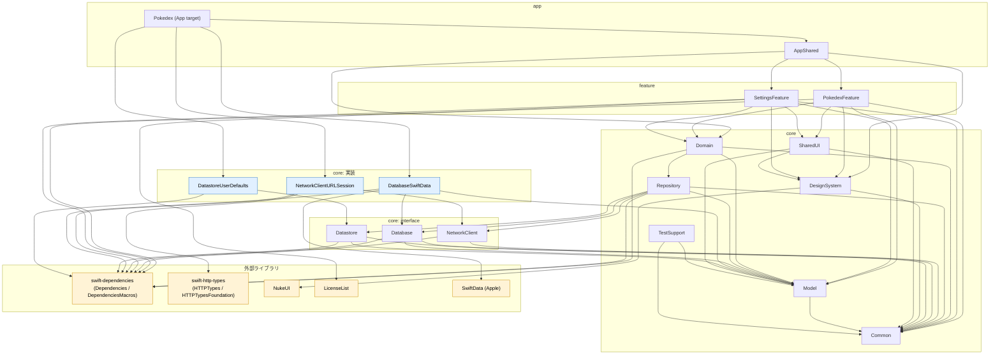

# モジュールと依存関係

swift-pokedex のモジュール構成、依存ルール、外部ライブラリの採否をまとめます。変わりにくい設計ルールのドキュメントです。決定の経緯は ADR を参照してください。

- [ADR 0003 モジュール構成](./adr/0003-multi-module-structure.md)
- [ADR 0005 外部ライブラリ選定](./adr/0005-external-libraries.md)
- [ADR 0008 モジュール命名規約](./adr/0008-module-naming.md)

## 目次

- [ディレクトリ構成](#ディレクトリ構成)
- [モジュール一覧](#モジュール一覧)
- [依存グラフ](#依存グラフ)
- [依存ルール](#依存ルール)
- [外部ライブラリ](#外部ライブラリ)
- [モジュール命名規約](#モジュール命名規約)
- [Package.swift の書き方の方針](#packageswift-の書き方の方針)
- [関連 ADR](#関連-adr)

## ディレクトリ構成

3 層（app / feature / core）で構成します。Now in Android や、開発者の既存 Flutter プロジェクトの `app/*`、`feature/*`、`core/*` と同じ考え方です。

```text
swift-pokedex/
├─ Package.swift
├─ README.md
├─ docs/
│   └─ adr/
├─ app/
│   ├─ Pokedex/                 … Xcode プロジェクト（@main のアプリ本体。実装モジュールをリンクして注入する）
│   └─ AppShared/               … ルート View、TabView、タブごとの NavigationStack と Router、テーマ適用
├─ feature/
│   ├─ PokedexFeature/          … Sources/{List,Detail,Favorites}、Tests、README.md
│   └─ SettingsFeature/         … Sources、Tests、README.md
└─ core/
    ├─ Common/                  … 共通ユーティリティ、エラー型
    ├─ Model/                   … ドメインの Entity（Sendable な struct / enum）
    ├─ NetworkClient/           … interface: PokeAPIClient と DTO（ネットワーク用モデル）
    ├─ NetworkClientURLSession/ … 実装: URLSession + swift-http-types
    ├─ Database/                … interface: FavoriteStore など
    ├─ DatabaseSwiftData/       … 実装: @Model、@ModelActor
    ├─ Datastore/               … interface: 設定値（テーマ色）
    ├─ DatastoreUserDefaults/   … 実装: UserDefaults
    ├─ Repository/              … Repository（NetworkClient / Database / Datastore を組み合わせ、DTO → Model 変換）
    ├─ Domain/                  … UseCase
    ├─ DesignSystem/            … テーマ、色、タイプバッジ、RemoteImage（Nuke をラップ）
    ├─ SharedUI/                … ドメインを知っている共通 UI（PokemonCard、PokemonRow など）
    └─ TestSupport/             … フィクスチャ、テスト用ヘルパー
```

各モジュールは `<ディレクトリ>/Sources` と `<ディレクトリ>/Tests` を持ちます。`app/Pokedex` は Xcode プロジェクトで、ルートの `Package.swift` をローカルパッケージとして参照します。

## モジュール一覧

種別の意味は次のとおりです。

| 種別 | 意味 |
| --- | --- |
| app | アプリ本体、または app 層の共通モジュール |
| feature | ドメイン単位の機能モジュール |
| core-interface | 依存の interface（`TestDependencyKey` と `testValue` / `previewValue` を定義） |
| core-impl | interface の実装（`DependencyKey` と `liveValue` を追加） |
| core | 上記以外の core モジュール |

| ディレクトリ | target 名 | 種別 | 責務 | Flutter 版で相当するパッケージ |
| --- | --- | --- | --- | --- |
| `app/Pokedex` | Pokedex | app | `@main`。実装モジュールをリンクして注入する唯一の場所 | `app/mobile` |
| `app/AppShared` | AppShared | app | ルート View、TabView、タブごとの NavigationStack と Router、テーマ適用 | `app/shared` |
| `feature/PokedexFeature` | PokedexFeature | feature | 図鑑ドメイン（List / Detail / Favorites） | `feature/*` |
| `feature/SettingsFeature` | SettingsFeature | feature | 設定（テーマ色、ライセンス表示、言語設定への誘導） | `feature/*` |
| `core/Common` | Common | core | 共通ユーティリティ、エラー型 | `core/common` 相当 |
| `core/Model` | Model | core | ドメイン Entity（Sendable な struct / enum） | `core/model` 相当 |
| `core/NetworkClient` | NetworkClient | core-interface | PokeAPIClient（API レベルの interface）と DTO | network 系 interface パッケージ |
| `core/NetworkClientURLSession` | NetworkClientURLSession | core-impl | URLSession + swift-http-types による実装 | network 系の実装パッケージ |
| `core/Database` | Database | core-interface | FavoriteStore などの interface | `database` |
| `core/DatabaseSwiftData` | DatabaseSwiftData | core-impl | `@Model` と `@ModelActor` による実装 | `database_drift` |
| `core/Datastore` | Datastore | core-interface | 設定値（テーマ色）の interface | `datastore` |
| `core/DatastoreUserDefaults` | DatastoreUserDefaults | core-impl | UserDefaults による実装 | `datastore_shared_preferences` |
| `core/Repository` | Repository | core | NetworkClient / Database / Datastore の組み合わせと DTO → Model 変換 | `core/data` |
| `core/Domain` | Domain | core | UseCase | `core/domain` |
| `core/DesignSystem` | DesignSystem | core | テーマ、色、タイプバッジ、RemoteImage（Nuke をラップ） | `core/designsystem` |
| `core/SharedUI` | SharedUI | core | ドメインを知っている共通 UI（PokemonCard、PokemonRow など） | `core/ui` |
| `core/TestSupport` | TestSupport | core | フィクスチャ、テスト用ヘルパー | テスト用ヘルパーのパッケージ |

「相当」と付けたものは、開発者の Flutter プロジェクトの実際のパッケージ名と差があるかもしれない対応です。厳密な名前の一致は意図していません。

## 依存グラフ

矢印は「依存元 → 依存先」です。`Dependencies` は swift-dependencies の `Dependencies` と `DependenciesMacros` をまとめて表記しています。



補足です。

- 依存の方向は常に app → feature → core です。逆向きの矢印はありません。
- 実装モジュール（青）に矢印を向けているのは Pokedex（App ターゲット）だけです。
- TestSupport は各モジュールの Tests ターゲットから使う想定です。上の図には通常ターゲットの依存だけを描いています。

## 依存ルール

| # | ルール | 理由 |
| --- | --- | --- |
| 1 | feature は Repository / NetworkClient / Database / Datastore を直接 import しない。必ず Domain の UseCase 経由にする（単純な委譲でも UseCase を置く） | データ取得の都合（HTTP、SwiftData、UserDefaults）が UI に漏れるのを防ぐ。開発者の Flutter プロジェクトと同じ運用にして迷いを減らす |
| 2 | feature 同士は依存しない | 機能の追加・削除・並行開発で互いに影響しないようにする。feature をまたぐ遷移が必要になったら delegate Action を AppShared の Router が受け取る |
| 3 | core は feature / app に依存しない | 依存の向きを一方向に保ち、循環を防ぐ |
| 4 | 実装モジュール（NetworkClientURLSession、DatabaseSwiftData、DatastoreUserDefaults）を依存に持つのは App ターゲットだけ | ライブ実装の差し替えとテスト容易性のため。Riverpod の ProviderScope の overrides に近い役割を App ターゲットと swift-dependencies が担う |
| 5 | Nuke に依存するのは DesignSystem だけ | 画像ライブラリの差し替え点を 1 か所に閉じ込める。他のモジュールは RemoteImage を使う |
| 6 | LicenseList に依存するのは SettingsFeature だけ（プラグインの適用先は導入時に確認する） | ライセンス表示は Settings の関心事であり、他へ広げない |
| 7 | SwiftData の `@Model` 型は DatabaseSwiftData の外に出さない | 永続化の技術詳細を interface の裏に隠し、Model の Entity だけをやり取りする |
| 8 | interface モジュールは実装モジュールに依存しない | 依存性逆転。interface 側に `testValue` / `previewValue` を置き、Preview とテストで実装モジュールを不要にする |

### 禁止事項のまとめ

- feature から Repository / NetworkClient / Database / Datastore を import すること
- PokedexFeature と SettingsFeature が互いに import すること
- core から feature / app を import すること
- App ターゲット以外から実装モジュールを import すること
- DesignSystem 以外から Nuke を、SettingsFeature 以外から LicenseList を import すること
- DatabaseSwiftData の外へ `@Model` 型を公開すること

SwiftPM では、直接の依存に書いていないモジュールでも推移的な依存として import できてしまう場合があります。`Package.swift` の宣言だけでは境界を完全には守れないため、導入時に明示的な依存チェック（例: `swift build` の `--explicit-target-dependency-import-check`）が使えるかを確認し、CI に組み込みます。

## 外部ライブラリ

方針は「標準で十分なものは標準を使い、実務で入れておく定番だけを入れる」です。バージョン番号はここには書きません。導入時に最新の安定版を確認します。

### 採用

選んだ理由は [ADR 0005](./adr/0005-external-libraries.md) を参照してください。

| ライブラリ | 用途 | 依存する target | 備考 |
| --- | --- | --- | --- |
| [swift-http-types](https://github.com/apple/swift-http-types) | `HTTPRequest` / `HTTPResponse` / `HTTPFields` の共通型。HTTPTypesFoundation が URLSession の拡張を提供する | NetworkClientURLSession | |
| [swift-dependencies](https://github.com/pointfreeco/swift-dependencies) | 依存性の注入（`@Dependency`、`@DependencyClient`） | NetworkClient、NetworkClientURLSession、Database、Datastore、Repository、Domain、PokedexFeature、SettingsFeature | |
| [Nuke](https://github.com/kean/Nuke)（NukeUI の `LazyImage`） | 画像のメモリ・ディスクキャッシュ | DesignSystem | 14 系はベータが出ているので、導入時に最新の安定版を確認する |
| [LicenseList](https://github.com/cybozu/LicenseList) | SPM 依存のライセンス一覧を生成し、`LicenseListView` で表示 | SettingsFeature | Swift 6.2 で書かれ Xcode 26.2 以上が必要。プラグインの適用先など導入手順は README に従い、導入時に確認する |
| [SwiftLint](https://github.com/realm/SwiftLint) | Lint | （開発ツール） | |
| [swift-format](https://github.com/swiftlang/swift-format) | 整形 | （開発ツール） | Swift ツールチェーンに同梱されている |
| [Swift Testing](https://developer.apple.com/documentation/testing) | テストフレームワーク | 各モジュールの Tests | |
| [swift-snapshot-testing](https://github.com/pointfreeco/swift-snapshot-testing) | スナップショットテスト | （余裕が出たら導入） | UI の回帰確認に有用。導入するかは後で検討する |

### 不採用

不採用にしたライブラリと理由は [ADR 0005 の検討した代替案](./adr/0005-external-libraries.md#検討した代替案)を参照してください（Alamofire / Moya、Realm、Kingfisher、Factory、TCA、swift-openapi-generator、R.swift / SwiftGen、XcodeGen / Tuist）。XcodeGen / Tuist を使わない場合の Xcode プロジェクトの管理方法は [ADR 0014](./adr/0014-xcode-project-management.md) を参照してください。

### Flutter のよく使うパッケージとの対応

| Flutter | Swift 版 | 備考 |
| --- | --- | --- |
| Freezed / json_serializable | struct・enum・`Codable` | コード生成は不要 |
| flutter_hooks | `@State`・`.task`・`.onChange` | 不要 |
| Signals | `@Observable` | 読んだプロパティだけを追跡する点が近い |
| Dio | URLSession + swift-http-types | |
| Injectable / get_it | swift-dependencies | |
| cached_network_image | Nuke | |

## モジュール命名規約

Apple SDK や標準ライブラリのモジュール名・型名と衝突する名前を避けます。理由は [ADR 0008](./adr/0008-module-naming.md) を参照してください。

| 避ける名前 | 衝突先・問題 | 採用する名前 |
| --- | --- | --- |
| Network | Network.framework と衝突 | NetworkClient |
| Data | `Foundation.Data` と衝突 | Repository（Now in Android / Flutter 版の `core/data` に相当） |
| Testing | Swift Testing と衝突 | TestSupport |
| UI | 汎用的すぎる | SharedUI |
| CoreXxx（接頭辞） | CoreData などの Apple フレームワークと紛らわしい | 付けない |

その他の規則です。

- feature は `XxxFeature` とする（PokedexFeature、SettingsFeature）。
- ディレクトリ名と target 名を一致させる。
- 実装モジュールは「interface 名 + 技術名」とする（NetworkClientURLSession、DatabaseSwiftData、DatastoreUserDefaults）。

## Package.swift の書き方の方針

- リポジトリのルートに `Package.swift` を 1 つだけ置く。モジュールごとに置く案は記述量が多いので採用しない。
- 各 target は `path` で `<ディレクトリ>/Sources` を、test target は `<ディレクトリ>/Tests` を指定する。
- 依存は target 単位で宣言する。推移的な依存の import を防ぐチェックは導入時に確認する（[依存ルール](#依存ルール)の補足を参照）。
- `Package` の `swiftLanguageModes: [.v6]` で、全 target を Swift 6 言語モードにする。
- Xcode プロジェクト（`app/Pokedex`）はルートのパッケージをローカルパッケージとして参照する。ワークスペースの要否など Xcode プロジェクトの細部は導入時に決める。同様の構成の例として [isowords](https://github.com/pointfreeco/isowords) がある。
- 外部ライブラリのバージョンは導入時に最新の安定版を確認して決める。

### 例

以下は構成のイメージを示す抜粋です。tools-version、外部パッケージのバージョン指定、product 名、`platforms` の書き方などは導入時に確定します。ここに書いた内容をそのまま使うわけではありません。

```swift
// swift-tools-version: （導入時に確定）
import PackageDescription

let package = Package(
    name: "swift-pokedex",
    platforms: [.iOS(.v26)],
    products: [
        // Xcode プロジェクトから参照する library product（導入時に確定）
        .library(name: "AppShared", targets: ["AppShared"]),
        .library(name: "NetworkClientURLSession", targets: ["NetworkClientURLSession"]),
    ],
    dependencies: [
        // from: は導入時に最新の安定版を確認して記入する
        .package(url: "https://github.com/pointfreeco/swift-dependencies", from: "（導入時に確認）"),
        .package(url: "https://github.com/apple/swift-http-types", from: "（導入時に確認）"),
    ],
    targets: [
        // core: interface
        .target(
            name: "NetworkClient",
            dependencies: [
                "Common",
                .product(name: "Dependencies", package: "swift-dependencies"),
                .product(name: "DependenciesMacros", package: "swift-dependencies"),
            ],
            path: "core/NetworkClient/Sources"
        ),
        // core: 実装
        .target(
            name: "NetworkClientURLSession",
            dependencies: [
                "NetworkClient",
                .product(name: "HTTPTypes", package: "swift-http-types"),
                .product(name: "HTTPTypesFoundation", package: "swift-http-types"),
                .product(name: "Dependencies", package: "swift-dependencies"),
            ],
            path: "core/NetworkClientURLSession/Sources"
        ),
        .testTarget(
            name: "NetworkClientURLSessionTests",
            dependencies: ["NetworkClientURLSession", "TestSupport"],
            path: "core/NetworkClientURLSession/Tests"
        ),
        // ...ほかの target も同じ形で書く
    ],
    swiftLanguageModes: [.v6]
)
```

`Common` と `TestSupport` の target 定義は省略しています。

## 関連 ADR

- [ADR 0003 モジュール構成](./adr/0003-multi-module-structure.md)
- [ADR 0005 外部ライブラリ選定](./adr/0005-external-libraries.md)
- [ADR 0008 モジュール命名規約](./adr/0008-module-naming.md)

関連ドキュメントです。

- [architecture.md](./architecture.md)
- [dependency-injection.md](./dependency-injection.md)
- [data-layer.md](./data-layer.md)
