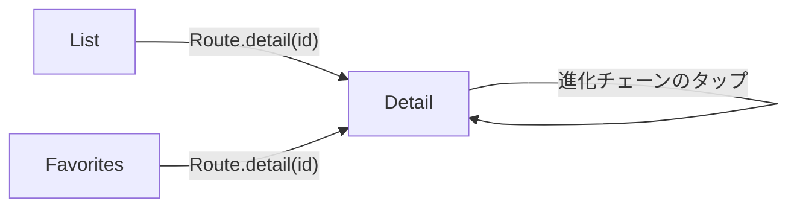

# PokedexFeature

> このドキュメントは生きた仕様書です。コードを変更する PR と同じ PR で更新します。

## 概要と責務

図鑑ドメインの画面をまとめる feature モジュールです。一覧、詳細、お気に入りを担当します。お気に入りは図鑑ドメインなので、独立した feature にせずここに含めています。

- 画面の State / Action / Store / View を持つ
- 図鑑内の画面遷移(Route と `navigationDestination`)を提供する
- データ取得は必ず [Domain](../../docs/architecture.md) の UseCase 経由で行う

全体の設計は [docs/architecture.md](../../docs/architecture.md)、依存ルールは [docs/package-dependencies.md](../../docs/package-dependencies.md)、DI の書き方は [docs/dependency-injection.md](../../docs/dependency-injection.md) を参照してください。

## 依存

依存ルール全般は [docs/package-dependencies.md](../../docs/package-dependencies.md#依存ルール) に従います。この feature 固有の点は次のとおりです。

- データ取得は UseCase 経由のみ（Repository / NetworkClient / Database / Datastore は import しない）
- 他の feature（SettingsFeature を含む）には依存しない
- テーマ色は Environment から読むだけで、SettingsFeature には依存しない（仕組みは [docs/architecture.md](../../docs/architecture.md#テーマ色の伝搬)）

## 画面一覧とフォルダ構成

| 画面 | フォルダ | 概要 |
| --- | --- | --- |
| List | `Sources/List` | 一覧、無限スクロール、検索、タイプフィルタ |
| Detail | `Sources/Detail` | 画像、タイプ、ステータス、説明文、進化チェーン、お気に入り切り替え |
| Favorites | `Sources/Favorites` | お気に入り一覧 |

```text
feature/PokedexFeature/
├─ README.md
├─ Sources/
│   ├─ List/
│   ├─ Detail/
│   ├─ Favorites/
│   └─ PokedexRoute.swift    … feature 内の Route
└─ Tests/
```

画面ごとに State(struct)、Action(enum)、Store(`@MainActor @Observable final class`)、View を持ちます。MVI の基本形は [docs/architecture.md](../../docs/architecture.md) を参照してください。

## 画面遷移

遷移は feature 内で完結します。App ターゲットがタブごとに持つ NavigationStack と Router(path を保持)に対し、PokedexFeature が Route と `navigationDestination` を提供します。



Route の例です(名前は仮)。

```swift
enum PokedexRoute: Hashable {
    case detail(id: Int)
}
```

feature をまたぐ遷移は現時点ではありません。必要になったら delegate Action(例: `.delegate(.selectPokemon(id))`)を App ターゲットの Router が受け取ります。

## 画面仕様

以降の State / Action / UseCase 名は案です。実装しながら見直します。

### List

| 項目 | 内容 |
| --- | --- |
| 表示項目 | 画像、ID、名前、タイプ(取得できる範囲) |
| 操作 | 末尾付近までスクロールで次ページ取得、行タップで Detail へ、検索欄への入力、タイプフィルタの選択 |
| PokeAPI | `GET /pokemon?limit=&offset=`(ページング)、`GET /pokemon/{id or name}`(行にタイプ等を出す場合)、`GET /type/{name}`(タイプフィルタ) |
| UseCase 案 | `FetchPokemonPageUseCase`、`FetchAllPokemonNamesUseCase`、`FetchPokemonByTypeUseCase` |

ページングは limit / offset 方式で、1ページのデフォルトは 20 件です。ID は `results` の url 末尾から取り出します。名前検索の API は無いため、全件の名前リスト(limit を count 以上にして1回取得)をキャッシュし、ローカルで絞り込みます。

State / Action の案です。

```swift
struct PokemonListState: Equatable {
    var items: [PokemonSummary] = []
    var phase: Phase = .idle          // idle / loading / loaded / failed
    var hasNext = true
    var query = ""
    var selectedType: PokemonType?
}

enum PokemonListAction {
    case onAppear
    case reachedBottom
    case pageResponse(Result<PokemonPage, any Error>)
    case queryChanged(String)
    case typeSelected(PokemonType?)
    case retryTapped
    case rowTapped(id: Int)
    case delegate(Delegate)
    enum Delegate { case selectPokemon(id: Int) }
}
```

検索の debounce は Store が Task を保持して cancel します(`Task.sleep` を使用)。

| 状態 | 表示 |
| --- | --- |
| 読み込み中(初回) | 全面の ProgressView |
| 読み込み中(次ページ) | リスト末尾に ProgressView |
| 空(検索・フィルタの結果なし) | 「該当するポケモンがいません」と条件のクリア導線 |
| エラー(初回) | エラーメッセージと再試行ボタン |
| エラー(次ページ) | 末尾に再試行行。取得済みの一覧は維持する |

### Detail

| 項目 | 内容 |
| --- | --- |
| 表示項目 | 公式アートワーク、ID、名前、タイプ、ステータス、説明文、進化チェーン |
| 操作 | お気に入りの追加・削除、進化チェーンのタップで別のポケモンの Detail へ |
| PokeAPI | `GET /pokemon/{id or name}`(types、stats、sprites)、`GET /pokemon-species/{id}`(names、flavor_text_entries、evolution_chain.url)、`GET /evolution-chain/{id}` |
| UseCase 案 | `FetchPokemonDetailUseCase`、`FetchPokemonSpeciesUseCase`、`FetchEvolutionChainUseCase`、`ToggleFavoriteUseCase`、`ObserveIsFavoriteUseCase` |

公式アートワークは `sprites.other["official-artwork"].front_default` から取得します。ID が 10000 を超えるものはフォーム違いなどの pokemon です。

```swift
struct PokemonDetailState: Equatable {
    var detail: PokemonDetail?
    var phase: Phase = .idle
    var isFavorite = false
}

enum PokemonDetailAction {
    case onAppear
    case detailResponse(Result<PokemonDetail, any Error>)
    case favoriteTapped
    case favoriteChanged(Bool)
    case retryTapped
}
```

| 状態 | 表示 |
| --- | --- |
| 読み込み中 | 全面の ProgressView |
| エラー | エラーメッセージと再試行ボタン |
| 説明文・進化チェーンが無い、または取得失敗 | そのセクションだけ非表示にし、画面全体は表示する |

### Favorites

| 項目 | 内容 |
| --- | --- |
| 表示項目 | お気に入りに追加したポケモンの一覧(画像、ID、名前) |
| 操作 | 行タップで Detail へ、スワイプまたは Detail 内でお気に入り解除 |
| PokeAPI | 保存済みの情報で足りない分は `GET /pokemon/{id}`(HTTP キャッシュが効く) |
| UseCase 案 | `ObserveFavoritesUseCase`(AsyncStream)、`ToggleFavoriteUseCase` |

View で `@Query` は使いません。Database interface 経由で fetch 関数または AsyncStream として受け取ります([docs/data-layer.md](../../docs/data-layer.md) 参照)。

```swift
struct FavoritesState: Equatable {
    var items: [PokemonSummary] = []
    var phase: Phase = .idle
}

enum FavoritesAction {
    case onAppear
    case favoritesChanged([PokemonSummary])
    case removeTapped(id: Int)
    case rowTapped(id: Int)
}
```

| 状態 | 表示 |
| --- | --- |
| 読み込み中 | ProgressView |
| 空 | 「お気に入りはまだありません」と図鑑タブへの案内 |
| エラー | エラーメッセージと再試行ボタン |
