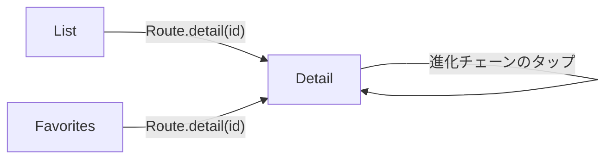

# PokedexFeature

> このドキュメントは生きた仕様書です。コードを変更する PR と同じ PR で更新します。

## 概要と責務

図鑑ドメインの画面をまとめる feature モジュールです。一覧、詳細、お気に入りを担当します。お気に入りは図鑑ドメインなので、独立した feature にせずここに含めています。

- 画面の State / Action / Store / View を持つ
- 図鑑内の画面遷移(Route と `navigationDestination`)を提供する
- データ取得は必ず [Domain](../../docs/architecture.md) の UseCase 経由で行う

全体の設計は [docs/architecture.md](../../docs/architecture.md)、依存ルールは [docs/package-dependencies.md](../../docs/package-dependencies.md)、DI の書き方は [docs/dependency-injection.md](../../docs/dependency-injection.md) を参照してください。

## 依存

依存ルール全般は [docs/package-dependencies.md](../../docs/package-dependencies.md#依存ルール) に従います。この feature 固有の点は次のとおりです。

- データ取得は UseCase 経由のみ（Repository / NetworkClient / Database / Datastore は import しない）
- 他の feature（SettingsFeature を含む）には依存しない
- テーマ色は Environment から読むだけで、SettingsFeature には依存しない（仕組みは [docs/architecture.md](../../docs/architecture.md#テーマ色の伝搬)）

## 画面一覧とフォルダ構成

| 画面 | フォルダ | 概要 |
| --- | --- | --- |
| List | `Sources/List` | 一覧、無限スクロール、検索、タイプフィルタ |
| Detail | `Sources/Detail` | 画像、タイプ、ステータス、説明文、進化チェーン、お気に入り切り替え |
| Favorites | `Sources/Favorites` | お気に入り一覧 |

```text
feature/PokedexFeature/
├─ README.md
├─ Sources/
│   ├─ List/
│   ├─ Detail/
│   ├─ Favorites/
│   └─ PokedexRoute.swift    … feature 内の Route
└─ Tests/
```

画面ごとに State(struct)、Action(enum)、Store(`@MainActor @Observable final class`)、View を持ちます。MVI の基本形は [docs/architecture.md](../../docs/architecture.md) を参照してください。

## 画面遷移

遷移は feature 内で完結します。App ターゲットがタブごとに持つ NavigationStack と Router(path を保持)に対し、PokedexFeature が Route と `navigationDestination` を提供します。



Route と対応表の形です。App ターゲットの Router は `path: [PokedexRoute]` を持ち、`NavigationStack(path:)` に渡します。

```swift
public enum PokedexRoute: Hashable, Sendable {
    case detail(id: Int)
}

// NavigationStack の中身に 1 回だけ付ける。Route から画面への対応表
.pokedexDestinations()
```

一覧の行は `NavigationLink(value: PokedexRoute.detail(id:))` です。行タップは Store を通しません(Store の Action にするほどの状態の変化が無いため)。

feature をまたぐ遷移は現時点ではありません。必要になったら delegate Action(例: `.delegate(.selectPokemon(id))`)を App ターゲットの Router が受け取ります。

## 画面仕様

以降の State / Action / UseCase 名は案です。実装しながら見直します。

### List

| 項目 | 内容 |
| --- | --- |
| 表示項目 | 画像(小さいドット絵 `spriteURL`)、ID、名前(アプリの言語)。タイプは出さない(下の「一覧の決めごと」) |
| 操作 | 最後の行が画面に出たら次ページ取得、行タップで Detail へ、検索欄への入力、タイプフィルタの選択 |
| PokeAPI | `GET /pokemon?limit=&offset=`(ページング)、`GET /type/{name}`(タイプフィルタ) |
| UseCase 案 | `FetchPokemonPageUseCase`、`FetchAllPokemonNamesUseCase`、`FetchPokemonByTypeUseCase` |

ページングは limit / offset 方式で、1ページは 20 件です(PokeAPI の初期値で、1 画面を少し超える量)。ID の取り出し方は [docs/data-layer.md](../../docs/data-layer.md) を参照してください。名前検索の API は無いため、全件の名前リスト(limit を count 以上にして1回取得)をキャッシュし、ローカルで絞り込みます。

一覧の決めごとです。

- 続きを読むタイミングは、最後の行の `onAppear` で `reachedBottom` を送ります。`onAppear` は何度も呼ばれるので、Store は読み込み中と `hasNext == false` のときの `reachedBottom` を無視します。
- ID が 10000 を超えるフォーム違いは一覧に入れず、詳細で扱います。PokeAPI の `/pokemon` は 1..1025 のあとに 10001.. が続くので、読んだページに ID > 10000 があれば捨てて `hasNext = false` にします。これは図鑑のきまりなので Domain の `FetchPokemonPageUseCase` で行います。
- 名前はアプリの言語で出します。日本語ならカナ(`ja-hrkt`)、それ以外は英語です（無いときの規則は [docs/data-layer.md](../../docs/data-layer.md#言語コードと変換ルール)）。名前は API を叩かず、同梱の表から出します（選び方は Domain の `FetchPokemonPageUseCase`、理由は [ADR 0018](../../docs/adr/0018-bundled-pokemon-names-table.md)、仕組みは [docs/data-layer.md](../../docs/data-layer.md#名前の表)）。名前での検索は #10 で足します。詳細画面の名前は API の species から取ります(下の Detail)。
- 行にタイプは出しません。出すには 1 行ごとに詳細 API を呼ぶことになり、PokeAPI の Fair Use Policy に反しやすいためです。出したくなったら、この理由を見直してから決めます。

State / Action です。一覧の実装に合わせてあり、検索とタイプフィルタは #10、#11 で足します。

```swift
struct State: Equatable {
    var items: [PokemonSummary] = []
    var phase: Phase = .idle          // idle / loading / loaded / failed(LoadError)
    var hasNext = true
}

enum Action {
    case onAppear
    case reachedBottom
    case retryTapped
}
```

エラーは `phase = .failed(LoadError)` に入れ、文言は View が `LoadError` から決めます。`CancellationError` は失敗にしません。行タップで Detail へ進む操作は Store を通さず、`NavigationLink` で行います(上の「画面遷移」)。

検索の debounce は Store が Task を保持して cancel します(`Task.sleep` を使用)。

| 状態 | 表示 |
| --- | --- |
| 読み込み中(初回) | 一覧の行と同じ形のスケルトンに shimmer（視差効果を減らす設定では動かさない） |
| 読み込み中(次ページ) | リスト末尾に ProgressView |
| 空(検索・フィルタの結果なし) | 「該当するポケモンがいません」と条件のクリア導線 |
| エラー(初回) | オフラインのときは接続を確認する文言、それ以外は時間をおいて再試行する文言。どちらも再試行ボタン |
| エラー(次ページ) | オフラインのときは接続を確認する文言、それ以外は時間をおいて再試行する文言。どちらも末尾の再試行行。取得済みの一覧は維持する |

### Detail

| 項目 | 内容 |
| --- | --- |
| 表示項目 | 公式アートワーク、ID、名前、分類、タイプ、高さ、重さ、種族値(6 つと合計)。説明文と進化チェーンは #17 で足す |
| 操作 | 再試行(失敗したとき)。お気に入りの追加・削除は #12、進化チェーンのタップで別のポケモンの Detail へ進む操作は #17 で足す |
| PokeAPI | `GET /pokemon/{id}`(types、stats、height、weight、sprites、species.url)、`GET /pokemon-species/{id}`(names、genera) |
| UseCase | `FetchPokemonDetailUseCase`。#17 で `FetchEvolutionChainUseCase`、#12 で `ToggleFavoriteUseCase`、`ObserveIsFavoriteUseCase` を足す |

取得の決めごとです。

- species の ID は、`/pokemon` の `species.url` の末尾から取ります。ID が 10000 を超えるフォーム違いは、pokemon の ID と species の ID が違うためです(`NetworkClientURLSession` の中で行う。[ADR-0017](../../docs/adr/0017-network-client-interface-independent-of-transport.md))。species の ID は pokemon の返事を見るまで分からないので、pokemon を取ってから species を取ります(同時には取れません)。
- どちらかが失敗したら、画面全体をエラーにします。species だけの失敗でも同じです。
- 名前と分類は、species の `names` と `genera` から、一覧と同じ言語の規則で 1 つ選びます([docs/data-layer.md](../../docs/data-layer.md#言語コードと変換ルール))。分類は `ja-hrkt`、`en` の順で探し、どちらも無ければ出しません。
- 高さと重さの API の値は 0.1 m / 0.1 kg 単位の整数です。画面では m と kg に固定し、小数 1 桁で出します。

タイプと種族値の決めごとです。選んだ理由と検討した代替案は [ADR-0019](../../docs/adr/0019-type-and-stat-names-and-colors-in-app.md) を参照してください。

- タイプ(18)と種族値(6)は Model の enum で持ちます。名前は `Localizable.xcstrings`、色はコード(`PokemonType+Appearance.swift`)に置きます。
- タイプの札は、タイプの色の地に白い文字です。色は、白い文字とのコントラスト比が 4.5:1 以上になる濃さにします(テストで 18 色すべてを確かめる)。
- アートワークの台は、一覧の行と同じ灰色です。タイプの色は着けません。色を持つのは札だけです。
- 種族値の棒(`ProgressView(value:total:)`、total は 255)は、テーマ色(tint)にします。一覧の #42 で決めた「テーマ色は操作できる部品だけ」の例外です。棒は文字でもボタンでもなく、押せると誤解されにくいためです。棒の地は無彩色です。

```swift
struct State: Equatable {
    var detail: PokemonDetail?
    var phase: Phase = .idle          // idle / loading / loaded / failed(LoadError)
}

enum Action {
    case onAppear
    case retryTapped
}
```

`onAppear` は何度も呼ばれるので、Store は読み込み中と読み込み済みのときの `onAppear` を無視します。エラーは `phase = .failed(LoadError)` に入れ、`CancellationError` は失敗にしません(一覧と同じ)。お気に入りの Action は #12 で足します。

| 状態 | 表示 |
| --- | --- |
| 読み込み中 | 全面の ProgressView |
| エラー | オフラインのときは接続を確認する文言、それ以外は時間をおいて再試行する文言。どちらも再試行ボタン |
| 説明文・進化チェーンが無い、または取得失敗(#17) | そのセクションだけ非表示にし、画面全体は表示する |

### Favorites

| 項目 | 内容 |
| --- | --- |
| 表示項目 | お気に入りに追加したポケモンの一覧(画像、ID、名前) |
| 操作 | 行タップで Detail へ、スワイプまたは Detail 内でお気に入り解除 |
| PokeAPI | 保存済みの情報で足りない分は `GET /pokemon/{id}`(HTTP キャッシュが効く) |
| UseCase 案 | `ObserveFavoritesUseCase`(AsyncStream)、`ToggleFavoriteUseCase` |

View で `@Query` は使いません。Database interface 経由で fetch 関数または AsyncStream として受け取ります([docs/data-layer.md](../../docs/data-layer.md) 参照)。

```swift
struct FavoritesState: Equatable {
    var items: [PokemonSummary] = []
    var phase: Phase = .idle
}

enum FavoritesAction {
    case onAppear
    case favoritesChanged([PokemonSummary])
    case removeTapped(id: Int)
    case rowTapped(id: Int)
}
```

| 状態 | 表示 |
| --- | --- |
| 読み込み中 | ProgressView |
| 空 | 「お気に入りはまだありません」と図鑑タブへの案内 |
| エラー | オフラインのときは接続を確認する文言、それ以外は時間をおいて再試行する文言。どちらも再試行ボタン |
