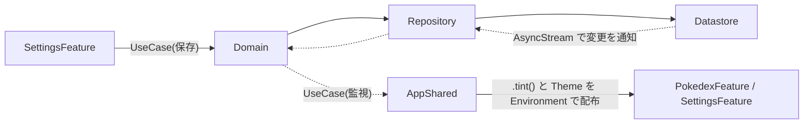

# SettingsFeature

> このドキュメントは生きた仕様書です。コードを変更する PR と同じ PR で更新します。

## 概要と責務

アプリの設定画面を担当する feature モジュールです。

- テーマ色の選択と保存
- 利用ライブラリのライセンス表示
- 言語設定への誘導
- アプリのバージョン表示(任意)

データの読み書きは [Domain](../../docs/architecture.md) の UseCase 経由で行い、Datastore を直接 import しません。全体の設計は [docs/architecture.md](../../docs/architecture.md)、依存ルールは [docs/package-dependencies.md](../../docs/package-dependencies.md) を参照してください。

## 依存してよいモジュール

| 依存先 | 用途 |
| --- | --- |
| Domain | UseCase の呼び出し |
| SharedUI | 共通 UI |
| DesignSystem | テーマ、色 |
| Model | Entity |
| Common | 共通ユーティリティ |
| Dependencies | `@Dependency` で UseCase を受け取る |
| LicenseList | ライセンス一覧の表示(依存するのはこの feature だけ) |

他の feature(PokedexFeature)には依存しません。

## 設定項目

| 項目 | 内容 | 実現方法 |
| --- | --- | --- |
| テーマ色 | プリセットから選ぶ(色の数や具体的な色は実装時に決める) | UseCase 経由で Datastore に保存 |
| ライセンス | 利用ライブラリのライセンス一覧 | LicenseList の `LicenseListView` |
| 言語 | iOS のアプリ別言語設定へ誘導 | `UIApplication.openSettingsURLString` で設定アプリのこのアプリのページを開く |
| バージョン表示(任意) | アプリのバージョンを表示 | Bundle の情報から取得(実装時に決める) |

言語をアプリ内で切り替える方式は採用していません(理由は [ADR 0007](../../docs/adr/0007-localization.md) を参照)。アプリ別言語設定で選べるのは、アプリ自体がローカライズしている言語(最初は ja と en)だけです。

ライセンス一覧は LicenseList が SPM 依存から生成します。プラグインの適用先など導入手順は LicenseList の README に従い、導入時に確認します。

## テーマ色が他の feature に伝わる仕組み

SettingsFeature は他の feature を直接参照しません。Datastore に保存された値を、AppShared が監視して Environment で配ります。



- 保存: SettingsFeature が UseCase を呼び、Datastore(実装は DatastoreUserDefaults)に保存する
- 監視: AppShared が UseCase(AsyncStream)で値を受け取り、`.tint()` と DesignSystem の Theme を Environment で全体に流す
- 利用側: PokedexFeature は Environment から読むだけで、SettingsFeature には依存しない

Flutter で例えると、Riverpod の Provider を Settings が更新し、ルートの `MaterialApp` が watch してテーマに反映するのに近い形です。

## State / Action の案

名前や構成は案です。実装しながら見直します。

```swift
struct SettingsState: Equatable {
    var selectedTheme: ThemeColor = .default   // ThemeColor は Model か DesignSystem の型(配置は実装時に決める)
    var availableThemes: [ThemeColor] = []
    var appVersion: String?
}

enum SettingsAction {
    case onAppear
    case themeLoaded(ThemeColor)
    case themeSelected(ThemeColor)
    case openLanguageSettingsTapped
    case licensesTapped
}
```

| Action | 処理 |
| --- | --- |
| `.onAppear` | 現在のテーマ色を UseCase で取得して `.themeLoaded` を送る |
| `.themeSelected` | state を更新し、UseCase で保存する |
| `.openLanguageSettingsTapped` | `UIApplication.openSettingsURLString` の URL を開く |
| `.licensesTapped` | ライセンス画面(`LicenseListView`)へ遷移する |

UseCase 案は `ObserveThemeColorUseCase`(AsyncStream。AppShared と共有)と `SaveThemeColorUseCase` です。Store は `@Dependency` で受け取ります。

## 画面表示の状態

| 状態 | 表示 |
| --- | --- |
| 読み込み中 | 保存済みの値が読めるまでは既定のテーマ色を表示 |
| 保存失敗 | エラーを表示し、表示中の選択を元に戻すかは実装時に決める |

## 実装フェーズ

フェーズ一覧と進捗は [GitHub Milestones](https://github.com/chippy-ao/swift-pokedex/milestones) で管理します。この feature は Phase 4 で実装します。

| フェーズ | 内容 |
| --- | --- |
| Phase 4 | Datastore、テーマ色、LicenseList、言語設定への誘導、String Catalog の ja / en |

## 未決事項

- プリセットの色の数と具体的な色
- テーマ色の型の配置(Model か DesignSystem か)
- ダークモードとの関係(テーマ色は tint のみで、背景色などは変えない想定だが実装時に確認する)
- LicenseList の導入手順(プラグインの適用先など。導入時に README で確認する)
- ライセンス画面の遷移方法(NavigationStack の push か sheet か)
- アプリのバージョン表示を入れるかどうか(任意)
- 保存失敗時の扱い
